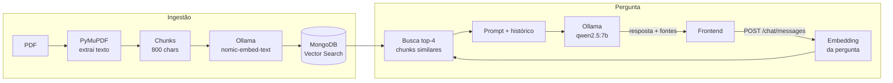

# 🎓 AcodeAI


API REST de um **tutor de IA para vestibular** (ENEM, FUVEST etc.). Você envia
apostilas e provas antigas em PDF; os alunos fazem perguntas e recebem
respostas **baseadas nesse material**, com as fontes usadas.

Tudo roda localmente e **sem custo**: os embeddings e o chat usam modelos
gratuitos do [Ollama](https://ollama.com), sem chave de API de terceiros.

---

## ✨ Funcionalidades

- **RAG sobre seus PDFs** — busca vetorial no MongoDB e resposta gerada só a partir do contexto encontrado.
- **Fontes na resposta** — cada resposta traz os trechos usados (título, matéria, score, excerto), prontos para o frontend exibir.
- **Conversas com histórico** — perguntas de acompanhamento ("e a aceleração?") entendem o contexto anterior.
- **Filtro por matéria** — História, Geografia, Física, Química, Biologia, Matemática, Linguagens e Geral.
- **Upload de PDF protegido** — endpoint administrativo com chave de API, validação de tipo e limite de tamanho.
- **Pronta para frontend** — CORS configurável, erros em JSON padronizado, OpenAPI/Swagger automático.
- **Robusta** — rate limit por IP, `503` claro quando o Ollama cai, health checks de liveness e readiness.

## 🧠 Como funciona



## 🏗️ Arquitetura

DDD em camadas; as dependências apontam sempre para dentro.

```
src/
├── domain/           # Entidades, value objects, portas (EmbeddingGenerator,
│                     # ChatCompleter), contratos de repositório, regras puras
├── app/              # Casos de uso e DTOs (responder dúvida, ingerir PDF, histórico)
├── infrastructure/   # Ollama, MongoDB, PyMuPDF, rate limiter, settings
├── bootstrap.py      # Raiz de composição: monta o Container de dependências
└── presentation/api/ # FastAPI: routers, schemas, dependências, tratamento de erros
scripts/              # Índice vetorial e ingestão de PDFs por linha de comando
tests/                # Testes (sem precisar de Mongo nem Ollama)
```

## 🚀 Início rápido

### Opção 1 — Docker (recomendada)

```bash
cp .env.example .env        # defina ao menos ADMIN_API_KEY
docker compose up -d --build
```

Sobe **MongoDB**, **Ollama** (baixa os modelos na primeira vez — pode levar
alguns minutos) e a **API** em `http://localhost:8000`. Em seguida, crie o
índice vetorial (uma vez):

```bash
docker compose exec api python -m scripts.create_vector_index
```

### Opção 2 — Local

**Pré-requisitos:** Python 3.13, [uv](https://docs.astral.sh/uv/), [Ollama](https://ollama.com) e Docker (para o MongoDB).

```bash
cp .env.example .env
uv sync

ollama pull qwen2.5:7b            # chat (~5 GB)
ollama pull nomic-embed-text      # embeddings (768 dimensões)
docker compose up -d mongodb

uv run python -m scripts.create_vector_index      # uma vez, antes da 1ª ingestão
uv run uvicorn src.presentation.api.main:app --reload
```

> ⚠️ Rodando o Ollama fora do Docker, inicie-o com
> `OLLAMA_CONTEXT_LENGTH=8192 ollama serve`. Sem isso o contexto padrão é curto
> e o prompt do RAG pode ser **truncado silenciosamente**.

Documentação interativa: **http://localhost:8000/docs**

### Indexando seu material

Pela API (admin):

```bash
curl -X POST http://localhost:8000/api/v1/documents \
  -H "X-API-Key: $ADMIN_API_KEY" \
  -F "file=@Fisica_Cinematica.pdf" \
  -F "subject=Fisica" \
  -F "title=Cinemática - Cap. 1"
```

Ou por linha de comando:

```bash
# um arquivo
uv run python -m scripts.ingest_cli caminho/arquivo.pdf Fisica "Cinemática - Cap. 1"

# em lote: coloque os PDFs em data/raw_pdfs/ nomeados Materia_Descricao.pdf
uv run python -m scripts.ingest_bulks_pdf
```

## 📡 API

Base: `/api/v1`. Erros seguem `{"detail": "..."}` (em erros de validação, `detail` é uma lista, padrão do FastAPI).

| Método | Rota | Descrição |
|---|---|---|
| `POST` | `/chat/messages` | Envia uma dúvida; devolve resposta + fontes |
| `GET` | `/chat/sessions/{session_id}` | Histórico da conversa |
| `DELETE` | `/chat/sessions/{session_id}` | Apaga o histórico (`204`) |
| `GET` | `/subjects` | Matérias válidas (`value` + `label`) |
| `POST` | `/documents` | 🔒 Admin — envia um PDF para indexação |
| `GET` | `/health` · `/health/ready` | Liveness · Readiness (MongoDB e Ollama), fora do prefixo `/api/v1` |

### `POST /chat/messages`

```bash
curl -X POST http://localhost:8000/api/v1/chat/messages \
  -H "Content-Type: application/json" \
  -d '{"question": "O que é velocidade média?", "subject": "Fisica"}'
```

```json
{
  "session_id": "8f1c2e1e-3b0e-4a43-9d35-0c1f0f8f2a77",
  "answer": "A **velocidade média** é a razão entre o espaço percorrido e o tempo...",
  "sources": [
    {
      "title": "Cinemática - Cap. 1",
      "subject": "Fisica",
      "score": 0.91,
      "excerpt": "A velocidade média é a variação do espaço dividida pelo tempo..."
    }
  ]
}
```

| Campo | Obrigatório | Regras |
|---|:-:|---|
| `question` | ✅ | 1 a 2000 caracteres |
| `subject` | | Um `value` de `GET /subjects` |
| `session_id` | | UUID. Omita na 1ª pergunta: a API cria e devolve |

| Status | Quando |
|---|---|
| `200` | Resposta gerada |
| `422` | Pergunta vazia/longa demais, matéria ou `session_id` inválidos |
| `429` | Limite de perguntas por IP; veja o header `Retry-After` |
| `503` | Ollama fora do ar, lento demais ou sem o modelo |

> Se nenhum trecho relevante for encontrado, `answer` traz uma mensagem padrão,
> `sources` vem vazio e a troca **não** entra no histórico.

### `POST /documents` (admin)

Multipart com `file` (PDF), `subject` e `title`, mais o header `X-API-Key`.

| Status | Quando |
|---|---|
| `201` | Indexado — devolve `chunks_created` |
| `401` | Chave ausente ou incorreta |
| `503` | `ADMIN_API_KEY` não configurada (endpoint desabilitado) |
| `413` | Arquivo maior que `MAX_UPLOAD_MB` |
| `415` | O arquivo não é um PDF |
| `422` | Matéria inválida ou PDF sem texto extraível (digitalizado) |

A resposta só chega ao fim da vetorização (segundos a minutos em PDFs grandes) —
use um timeout generoso. **Nunca coloque a chave admin no código do navegador**;
use um painel protegido ou chame o upload a partir de um backend.

## 🖥️ Consumindo no frontend

```ts
const API = "http://localhost:8000/api/v1";

export async function ask(question: string, subject?: string) {
  const sessionId = localStorage.getItem("acodeai:session") ?? undefined;

  const res = await fetch(`${API}/chat/messages`, {
    method: "POST",
    headers: { "Content-Type": "application/json" },
    body: JSON.stringify({ question, subject, session_id: sessionId }),
  });

  if (res.status === 429) throw new Error(`Aguarde ${res.headers.get("Retry-After")}s`);
  if (!res.ok) throw new Error((await res.json()).detail ?? "Erro inesperado");

  const data = await res.json();
  localStorage.setItem("acodeai:session", data.session_id);
  return data; // { session_id, answer, sources }
}
```

- Libere a origem do seu frontend em `CORS_ALLOW_ORIGINS`.
- O schema em `/openapi.json` serve para gerar um client tipado
  (ex.: `openapi-typescript`).
- As respostas vêm em **Markdown** (negrito, listas) — renderize no frontend.
- Modelos locais podem levar dezenas de segundos; mostre um indicador de carregamento.

## ⚙️ Configuração

Copie `.env.example` para `.env`. Só `MONGO_URI` é obrigatória.

| Variável | Padrão | Descrição |
|---|---|---|
| `MONGO_URI` | — | String de conexão do MongoDB |
| `MONGO_DB_NAME` | `acode-ai` | Nome do banco |
| `MONGO_ROOT_USERNAME` / `MONGO_ROOT_PASSWORD` | — | Credenciais do Mongo local (docker-compose) |
| `ADMIN_API_KEY` | vazio | Chave do `X-API-Key` para upload; vazia = upload desabilitado |
| `CORS_ALLOW_ORIGINS` | `localhost:5173,localhost:3000` | Origens do frontend, separadas por vírgula |
| `MAX_UPLOAD_MB` | `25` | Tamanho máximo do PDF |
| `OLLAMA_BASE_URL` | `http://localhost:11434/v1` | Endpoint OpenAI-compatível do Ollama |
| `OLLAMA_CHAT_MODEL` | `qwen2.5:7b` | Modelo de chat |
| `OLLAMA_EMBEDDING_MODEL` | `nomic-embed-text` | Modelo de embeddings |
| `OLLAMA_MAX_TOKENS` | `2048` | Limite de tokens da resposta |
| `OLLAMA_TIMEOUT_SECONDS` | `180` | Timeout das chamadas ao Ollama |
| `EMBEDDING_DIMENSIONS` | `768` | Dimensão do vetor; deve bater com o modelo e o índice |
| `RATE_LIMIT_REQUESTS` | `5` | Perguntas por IP na janela |
| `RATE_LIMIT_WINDOW_SECONDS` | `60` | Janela do rate limit (s) |

**Trocando de modelo:** qualquer modelo de chat do Ollama serve
(`llama3.2:3b` para máquinas mais fracas). Se trocar o modelo de
**embeddings**, ajuste `EMBEDDING_DIMENSIONS`, recrie o índice vetorial e
**reingira todos os PDFs** — vetores de modelos diferentes não são comparáveis,
mesmo com a mesma dimensão.

## 🧪 Testes

```bash
uv run pytest
```

A suíte (21 testes) usa repositórios e IA falsos, então **não precisa de
MongoDB nem Ollama**. Cobre endpoints, validações, rate limit, autenticação
admin, upload de PDF, CORS e o adaptador do Ollama (com transporte HTTP simulado).

## 🔧 Solução de problemas

| Sintoma | Causa provável |
|---|---|
| `503` ao perguntar | Ollama fora do ar ou modelo não baixado — rode `ollama pull <modelo>`; veja `/health/ready` |
| Respostas "não encontrei informações" sempre | Índice vetorial não criado, nenhum PDF ingerido ou ingestão feita com outro modelo de embeddings |
| Erro de dimensão (`EMBEDDING_DIMENSIONS`) | Modelo de embeddings diferente do índice — veja "Trocando de modelo" |
| Resposta ignora parte do material | Contexto do Ollama curto demais — use `OLLAMA_CONTEXT_LENGTH=8192` |
| Erro de CORS no navegador | Origem do frontend ausente em `CORS_ALLOW_ORIGINS` |
| `429` em uso normal | Atrás de proxy reverso sem `--proxy-headers`: todos aparecem com o mesmo IP |

## 🗺️ Limitações e próximos passos

- **Sem autenticação de usuários** — o `session_id` (UUID não adivinhável) é a única proteção de uma conversa. Para contas reais: login/JWT e sessões associadas ao usuário.
- **Sem streaming** — a resposta chega inteira. SSE em `/chat/messages/stream` é o próximo passo natural para a UX.
- **Rate limiter em memória** — com várias réplicas, migre para Redis.
- **Sem OCR** — PDFs digitalizados (imagem) não geram texto.
- **Driver `motor` depreciado** (fim do suporte previsto para maio/2027) — migrar para a API assíncrona nativa do PyMongo.
- **Prefixos do `nomic-embed-text`** — o modelo rende melhor com `search_document: ` na ingestão e `search_query: ` na pergunta; ainda não aplicados.

## 🔄 Notas de migração

- **Discord → API:** o bot foi removido. O histórico agora é por `session_id` (UUID); sessões antigas (campo `user_id`) ficam órfãs em `chat_sessions` e podem ser apagadas.
- **Gemini/DeepSeek → Ollama:** apague a coleção `document_chunks` e reingira os PDFs.
- O metadado `source_path` dos chunks virou `source_file` (só o nome do arquivo).
